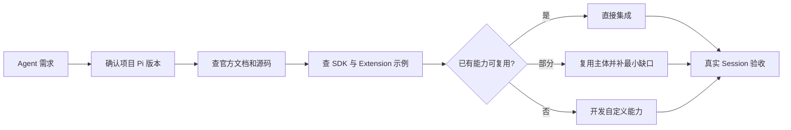

# Pi Development Skill

> 想做一个自己的 Agent，又不想从 Agent Loop、Session、工具调用和上下文管理开始重写，可以从这里开始。

`pi-development` 是一份面向开发者和 Coding Agent 的开发 Skill。它指导 Agent 基于 [Pi](https://github.com/badlogic/pi-mono) 的官方文档、源码和示例开发自己的 Agent。

它不提供一套新的 Agent 框架。它帮助你先找到 Pi 已经提供的能力，再补上真正缺少的部分。

## 它适合做什么

你可以用它开发：

- 接入自定义模型、系统提示词和 Skills 的个人 Agent；
- 能自主调用搜索、地图、数据库、浏览器或业务接口的工具 Agent；
- 带 Session、历史记录、流式事件和工具过程展示的 Agent 应用；
- 带 Web UI、RPC 或终端界面的调试工具；
- 基于 MCP、Extension、Subagent 和 Pi Package 的复杂 Agent Runtime；
- 对现有 Pi Agent 做架构调整、问题排查和版本升级。

例如：

```text
$pi-development 帮我做一个本地验真 Agent：
- 使用 Pi SDK
- 支持 Skills
- 接入搜索和地图 MCP
- 页面展示流式回复和工具调用
- 开发前先检查 Pi 官方是否已有可复用能力
```

## 核心原则

每次开发新功能，先按下面的顺序检查：

1. 当前项目已经使用了哪些 Pi 能力；
2. 项目实际安装的 Pi 版本支持什么；
3. Pi 官方文档和源码是否已有对应 API；
4. 官方 SDK 和 Extension 示例是否已有可复用实现；
5. 官方 Skills、Pi Package 或社区扩展是否已经解决；
6. 以上都不满足时，再写最小的自定义代码。



Pi 已经提供 Agent Loop、Session、事件、工具调度、Skills、Compaction 或资源加载时，不再重复实现一套。

## 先选对扩展方式

| 你的需求 | 优先使用 |
| --- | --- |
| 给 Agent 增加按需加载的工作方法和知识 | Skill |
| 保存一段可复用的输入模板 | Prompt Template |
| 增加工具、命令、事件钩子、权限门禁或终端 UI | Extension |
| 把 Pi 嵌入自己的 TypeScript 应用 | SDK |
| 用网页、其他语言或独立进程控制 Pi | RPC、JSON Mode 或 CLI Integration |
| 接入外部搜索、地图、数据库和业务服务 | MCP 或轻量 Extension Adapter |
| 分享一组 Extensions、Skills、Prompts 和 Themes | Pi Package |

## 安装

### 安装到 Codex

```bash
git clone https://github.com/2894832607/pi-development-skill.git \
  ~/.codex/skills/pi-development
```

如果之前就是通过 `git clone` 安装的：

```bash
git -C ~/.codex/skills/pi-development pull
```

### 安装到兼容 Agent Skills 的工具

Pi 支持标准 Agent Skills 目录，可以安装到：

```bash
git clone https://github.com/2894832607/pi-development-skill.git \
  ~/.agents/skills/pi-development
```

也可以放进具体项目：

```text
your-project/
└── .agents/
    └── skills/
        └── pi-development/
```

不同宿主的 Skill 搜索路径可能不同。安装后确认宿主能发现 `SKILL.md`。

## 使用

显式调用：

```text
$pi-development 帮我基于 Pi 开发一个支持多轮工具调用的研究 Agent。
```

也可以把约束一次说清楚：

```text
$pi-development 检查这个项目的 Pi 版本和现有架构。
我要增加一个 Web UI，可以看到流式回复、模型返回的 thinking block、
工具名称、参数和结果。先查官方文档、官方示例和现成 Extension，
能复用的直接复用，不要重写 Agent Loop。
```

Skill 会先给出：

- 当前项目使用的 Pi 版本；
- 查过的官方文档、源码和示例；
- 可以直接复用的 Pi 能力；
- 仍需开发的最小缺口；
- 实现方案和验收方式。

## 推荐的开发流程

1. **确认契约**：明确输入、输出、工具、Session、UI 和验收标准。
2. **确认版本**：读取 `package.json`、lockfile、依赖树和已安装的 TypeScript 类型。
3. **查找复用**：查官方文档、源码、SDK 示例、Extension 示例、Skills 和 Packages。
4. **最小实现**：保留 Pi 自带的 Agent Loop 和生命周期，只补业务缺口。
5. **真实验收**：启动一个真实 Session，验证 Prompt、工具事件、最终回复和资源释放。

## 官方资料

完整链接索引在 [references/official-sources.md](references/official-sources.md)，包括：

- Pi 官方仓库和 Coding Agent 源码；
- How Pi Works、Quickstart 和 SDK；
- Extension API、生命周期、事件、工具和 UI；
- MCP、RPC、Sessions、Messages 和 Compaction；
- Skills、Prompt Templates、Slash Commands 和 Pi Packages；
- 官方 SDK、Extension 和 Subagent 示例。

具体开发模式和示例映射在 [references/engineering-playbook.md](references/engineering-playbook.md)。

## 目录

```text
pi-development-skill/
├── SKILL.md
├── README.md
├── agents/
│   └── openai.yaml
└── references/
    ├── official-sources.md
    └── engineering-playbook.md
```

## 需要知道的边界

- 这个仓库是开发 Skill，不是开箱即用的 Agent 产品。
- 它不会替你安装模型、申请 API Key 或启动外部 MCP 服务。
- Pi 官方 `main` 可能比项目安装版本更新，实际开发以项目锁定版本为准。
- UI 可以展示模型实际返回的 reasoning 或 thinking block，不能承诺展示未返回的隐式思维链。
- 工具调用成功只说明请求执行了，最终结果仍要核对参数、实体和返回证据。

开发时优先使用官方 API 和示例。无法在目标版本中确认的接口，不要凭记忆补出来。
